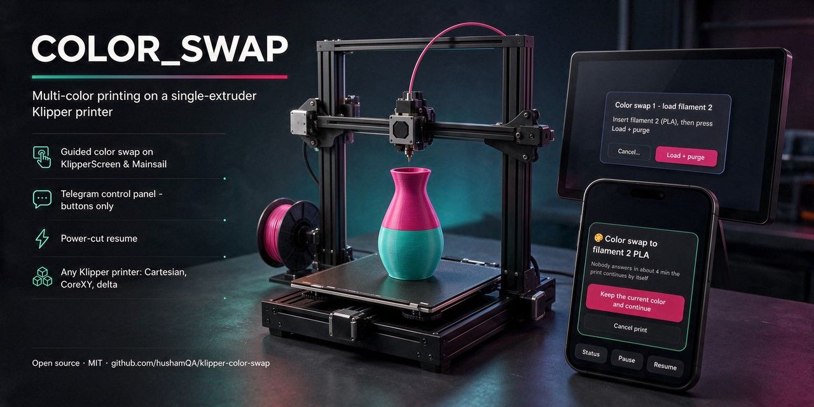
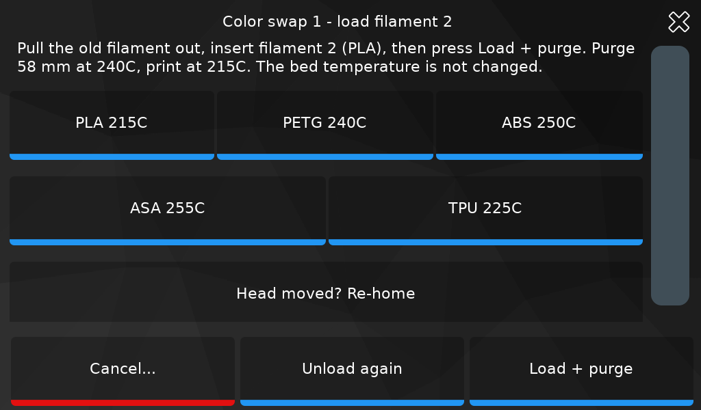
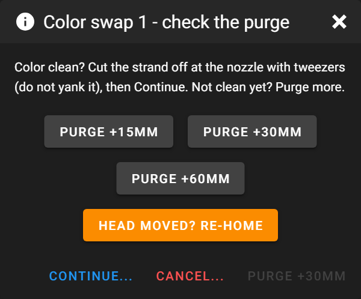
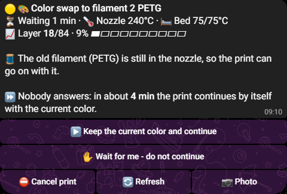

**العربية** | [English](README.md)

# SwapPilot — طباعة عدة ألوان بطابعة Klipper ذات رأس واحد

> **SwapPilot** هو الاسم الجديد لـ **COLOR_SWAP** (نوفمبر 2026). الماكروهات تبقى بأسمائها (`COLOR_SWAP` و`COLOR_SWAP_CHECK` و`COLOR_SWAP_SETTINGS`...)، فلا يتغيّر شيء في OrcaSlicer ولا على الطابعة. الروابط القديمة إلى `klipper-color-swap` تصل إلى هنا وحدها.

ملف طباعة **واحد** من OrcaSlicer. كلما احتاجت الطباعة لونًا آخر تتوقف الطابعة وحدها، وترفع الرأس فوق النموذج، وتفتح نافذة على شاشة الطابعة (KlipperScreen) وفي Mainsail. تبدّل الخيط، تضغط زرًا، وتكمل الطباعة من نفس المكان تمامًا.

إعداد **هشام محمد عثمان** ([@hushamQA](https://github.com/hushamQA)). كُتب وجُرّب على **FLSUN V400** (دلتا). الطابعات الكارتيزية و CoreXY وذات السرير المتحرك تستعمل نفس الملف `color_swap.cfg`.

التثبيت: [`INSTALL.ar.md`](INSTALL.ar.md)

> 🎬 **فيديو الشرح (دقيقتان):** [`video/COLOR_SWAP_tutorial_AR_v2.mp4`](video/COLOR_SWAP_tutorial_AR_v2.mp4)
> صُوّر على **الإصدار 2**: الفكرة نفسها، لكن النوافذ تغيّرت بعده (Continue صار على اليسار، وأزرار الصخ 15 / 30 / 60 مم، والإصدار 6 أضاف نافذة الإعدادات). المرجع الصحيح هو هذا الملف.

<table><tr>
<td align="center" valign="top"> KlipperScreen</td>
<td align="center" valign="top"> Mainsail</td>
<td align="center" valign="top"> Telegram</td>
</tr></table>

| 📖 الدليل | 📦 التحميل | 🛠️ التثبيت |
|---|---|---|
| **[الويكي](https://github.com/hushamQA/klipper-swappilot/wiki/%D8%A7%D9%84%D8%AF%D9%84%D9%8A%D9%84-%D8%A8%D8%A7%D9%84%D8%B9%D8%B1%D8%A8%D9%8A%D8%A9)** — كل نافذة، كل إعداد، حل المشاكل (عربي وإنجليزي) | **[Releases](https://github.com/hushamQA/klipper-swappilot/releases)** — حزمة كل إصدار وما تغيّر فيه | **[INSTALL.ar.md](INSTALL.ar.md)** — FLSUN V400 في 10 دقائق، وأي طابعة Klipper في 15 |

## ماذا يفعل

| | |
|---|---|
| 🎨 **تبديل موجَّه** | سحب، تحميل + صخ، فحص اللون، متابعة — زر واحد لكل خطوة، ونفس النافذة على KlipperScreen و Mainsail |
| 🧪 **صخ مناسب كل مرة** | يأخذ كمية الصخ من Orca، ويضيف عند تغيّر الخامة وعند الرجوع للفيلمنت الأساسي، ويصخ على دفعات |
| ✈️ **HOME / AWAY** | AWAY: لا أحد عند الطابعة؟ بعد 5 دقائق تكمل الطباعة باللون الموجود. تغيير الخامة ينتظر شخصًا دائمًا |
| 📱 **لوحة تحكم Telegram** | لوحة واحدة مثبّتة تتحدّث وحدها، وبطاقة التبديل، وتنبيه قبل كل تبديل بـ 10 دقائق — أزرار فقط |
| 📷 **الكاميرا في المحادثة** | صورة عند كل مرحلة تبديل (افحص لون التنظيف من بعيد)، وفيديو حي 10 ثوانٍ، وفيديو التايم لابس لكل طباعة مكتملة يصل إلى Telegram |
| ⚡ **الاستكمال بعد انقطاع الكهرباء** | نقطة حفظ كل طبقة؛ استكمال الطباعة المتوقفة من الشاشة |
| 🛡️ **آمن من الأساس** | الفوهة لا تنزل أبدًا تحت النقطة التي أوقف عندها السلايسر الطباعة |
| ⚙️ **الإعدادات على الشاشة** | لكل رقم زر وشرح وقيمة مصنع — بلا تعديل ملفات |

## البدء السريع

1. حمّل الحزمة من آخر **[إصدار](https://github.com/hushamQA/klipper-swappilot/releases/latest)**.
2. ثبّتها: [`INSTALL.ar.md`](INSTALL.ar.md) — ارفع `color_swap.cfg`، أضفه بـ include، ثم **Save & Restart**، وشغّل `COLOR_SWAP_CHECK`.
3. OrcaSlicer: فعّل **Manual filament change**، وضع سطر **Change filament G-code** من الملف `orca_change_filament_gcode.txt` ‏([إعداد OrcaSlicer](https://github.com/hushamQA/klipper-swappilot/wiki/%D8%A5%D8%B9%D8%AF%D8%A7%D8%AF-OrcaSlicer)).
4. اطبع. عند كل تبديل لون اتبع النافذة: **Load + purge ← Continue... ← اقطع الخيط ← Yes, continue print** ‏([أثناء الطباعة](https://github.com/hushamQA/klipper-swappilot/wiki/%D8%A3%D8%AB%D9%86%D8%A7%D8%A1-%D8%A7%D9%84%D8%B7%D8%A8%D8%A7%D8%B9%D8%A9)).
5. اختياري: تنبيهات الهاتف ولوحة تحكم Telegram ‏([لوحة Telegram](https://github.com/hushamQA/klipper-swappilot/wiki/%D9%84%D9%88%D8%AD%D8%A9-Telegram)).

## الإصدار الحالي

**6.6 (2026-11-22)** — اللون الجديد يبدأ فورًا: زر **Continue...** يملأ الفوهة بـ 5 مم بلاستيك جديد قبل أن تقطع الخيط، والسحب عاد سحبة واحدة، وصخ الرجوع للفيلمنت الأساسي أقصر بـ 20 مم. كل الإصدارات وملاحظاتها: **[Releases](https://github.com/hushamQA/klipper-swappilot/releases)**.

تحمل الحزمة أيضًا الدليل كاملًا بلا إنترنت في [`wiki/`](wiki/)، واختبارات المحاكاة في [`sim/`](sim/) ‏(418 فحصًا على طابعة دلتا وكارتيزية و CoreXY).

## الرخصة

MIT — انظر [`LICENSE`](LICENSE). © 2026 هشام محمد عثمان. استعمله وعدّله بحرية مع ذكر المصدر.

