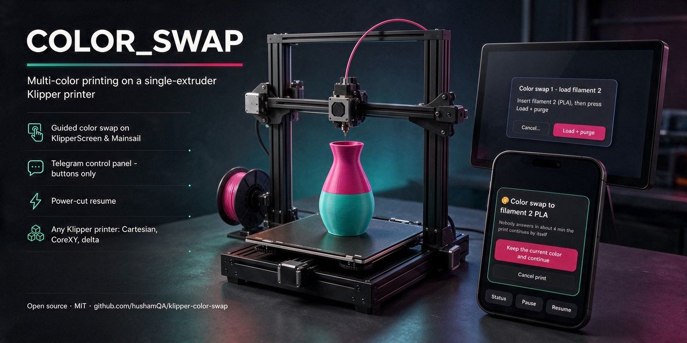
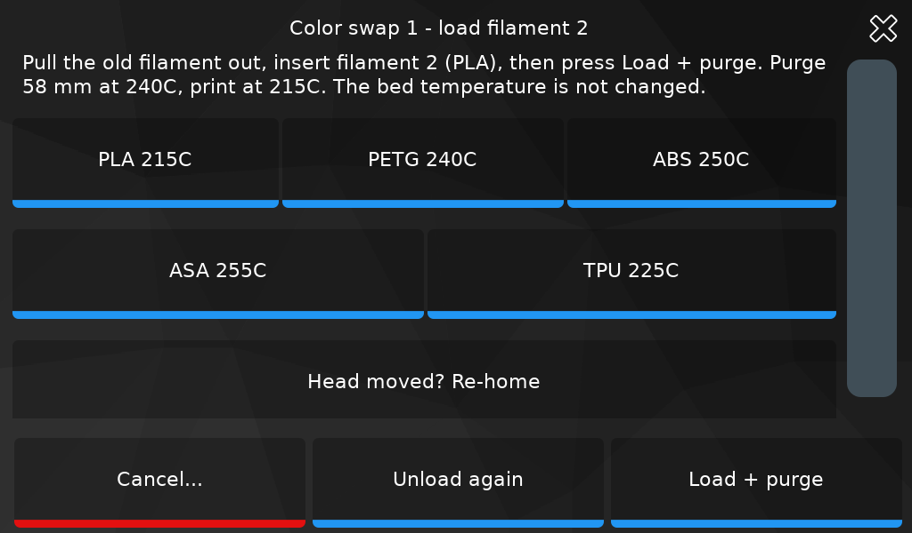
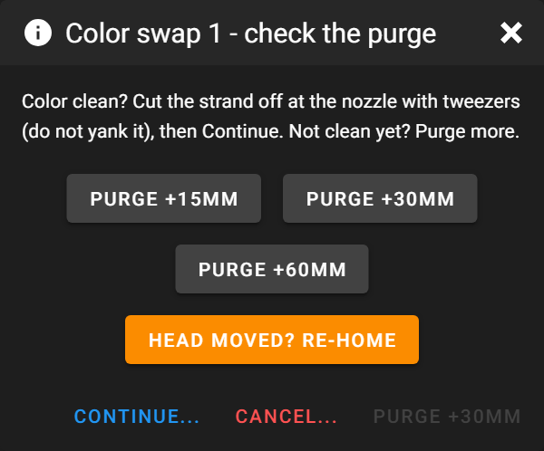
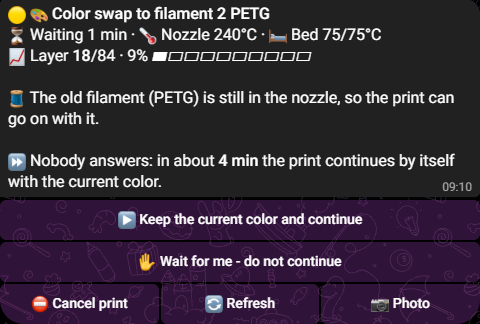

**English** | [العربية](README.ar.md)

# SwapPilot — multi-color printing on a single-extruder Klipper printer

> **SwapPilot** is the new name of **COLOR_SWAP** (November 2026). The macros keep their names (`COLOR_SWAP`, `COLOR_SWAP_CHECK`, `COLOR_SWAP_SETTINGS`...), so nothing changes in OrcaSlicer or on the printer. Old links to `klipper-color-swap` lead here by themselves.

**One** print file from OrcaSlicer. Whenever the print needs another color, the printer pauses by itself, parks the head above the model and opens a window on the printer screen (KlipperScreen) and in Mainsail. You swap the filament, press a button, and the print goes on exactly where it stopped.

By **Husham Mohammed Osman** ([@hushamQA](https://github.com/hushamQA)). Written and tested on a **FLSUN V400** (delta). Cartesian, CoreXY and bed-slinger printers use the same `color_swap.cfg`.

Installation: [`INSTALL.md`](INSTALL.md)

> 🎬 **Tutorial video (2 minutes, Arabic):** [`video/COLOR_SWAP_tutorial_AR_v2.mp4`](video/COLOR_SWAP_tutorial_AR_v2.mp4)
> Recorded on **version 2**: the idea is the same, but the windows have changed since (Continue is on the left, purge buttons 15 / 30 / 60 mm, and version 6 added the settings window). This file is the correct reference.

<table><tr>
<td align="center" valign="top"> KlipperScreen</td>
<td align="center" valign="top"> Mainsail</td>
<td align="center" valign="top"> Telegram</td>
</tr></table>

| 📖 Manual | 📦 Download | 🛠️ Install |
|---|---|---|
| **[Wiki](https://github.com/hushamQA/klipper-swappilot/wiki)** — every window, every setting, troubleshooting (English and Arabic) | **[Releases](https://github.com/hushamQA/klipper-swappilot/releases)** — the package of each version and what changed | **[INSTALL.md](INSTALL.md)** — FLSUN V400 in 10 minutes, any Klipper printer in 15 |

## What it does

| | |
|---|---|
| 🎨 **Guided swap** | Unload, load + purge, check the color, continue — one button per step, the same window on KlipperScreen and Mainsail |
| 🧪 **Right purge every time** | Takes Orca's flushing volume, adds extra for a material change and for going back to the main filament, purges in pulses |
| ✈️ **HOME / AWAY** | AWAY: nobody at the printer? After 5 min the print goes on with the color it has. A change of material always waits for a person |
| 📱 **Telegram control panel** | One pinned, self-updating panel, the swap card, a warning 10 min before each swap — buttons only |
| 📷 **Camera in the chat** | A photo at every swap step (check the purge color from far away), 10 s live videos, and the timelapse of each complete print sent to Telegram |
| ⚡ **Power-cut resume** | Save points every layer; resume a stopped print from the screen |
| 🛡️ **Safe by design** | The nozzle never goes below the point where the slicer paused it |
| ⚙️ **Settings on the screen** | Every number has a button, an explanation and a factory value — no file editing |

## Quick start

1. Download the package from the latest **[release](https://github.com/hushamQA/klipper-swappilot/releases/latest)**.
2. Install it: [`INSTALL.md`](INSTALL.md) — upload `color_swap.cfg`, include it, **Save & Restart**, run `COLOR_SWAP_CHECK`.
3. OrcaSlicer: **Manual filament change** on, and the one-line **Change filament G-code** from `orca_change_filament_gcode.txt` ([OrcaSlicer setup](https://github.com/hushamQA/klipper-swappilot/wiki/OrcaSlicer-Setup)).
4. Print. At each color swap follow the window: **Load + purge → Continue... → cut the strand → Yes, continue print** ([During the print](https://github.com/hushamQA/klipper-swappilot/wiki/During-the-Print)).
5. Optional: phone alerts and the Telegram control panel ([Telegram panel](https://github.com/hushamQA/klipper-swappilot/wiki/Telegram-Panel)).

## Current version

**6.6 (2026-11-22)** — the new color starts at once: **Continue...** refills the nozzle with 5 mm of fresh plastic before you cut the strand, unloading is one pull again, and the purge back to the main filament is 20 mm shorter. Every version and its notes: **[Releases](https://github.com/hushamQA/klipper-swappilot/releases)**.

The package also carries the whole manual offline in [`wiki/`](wiki/), and the simulator tests in [`sim/`](sim/) (418 checks on a delta, a Cartesian and a CoreXY printer).

## License

MIT — see [`LICENSE`](LICENSE). © 2026 Husham Mohammed Osman. Use and modify it freely, with credit.
