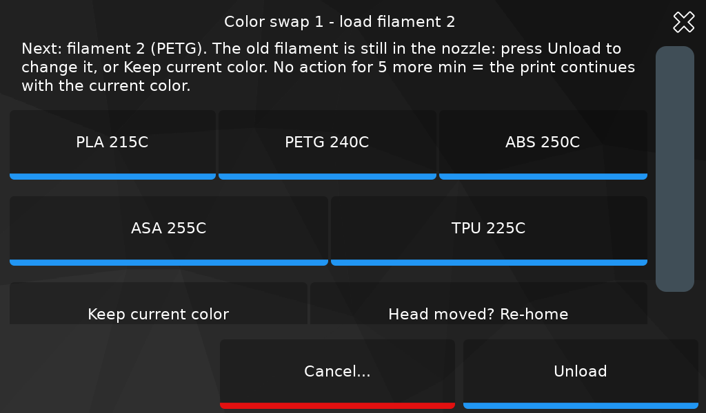
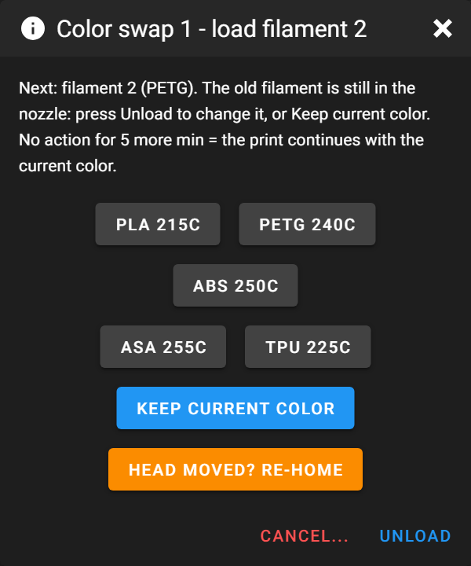
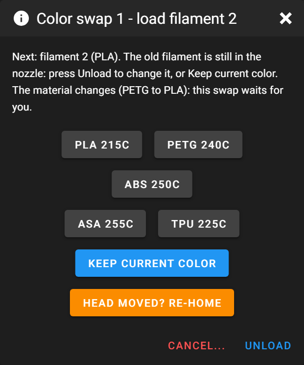
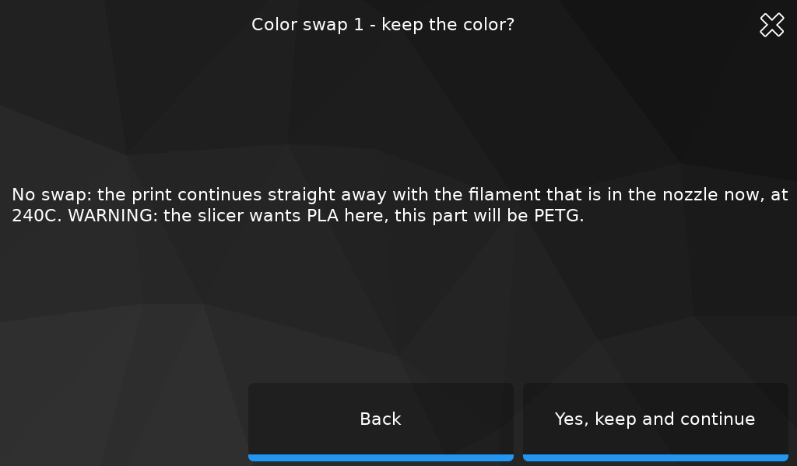
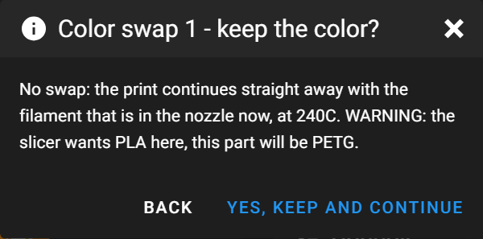

**English** | [العربية](%D9%88%D8%B6%D8%B9-AWAY)

## Auto continue with the current color

**AWAY is the factory mode** (since 6.3), with 5 min: whoever starts a print, a swap that only changes the color goes on by itself. A swap that changes the material type always waits for somebody (6.5). **Color swap settings → I am AWAY** — one tap switches to **HOME** when you want every swap to wait for you. The waiting time is the button below it (5 min).

| What happens at a swap | |
|---|---|
| The head parks. The old filament **stays in** (it is what the print may continue with) | Window: **Unload** / **Keep current color** |
| You press anything | Auto continue is off for this swap; it now waits for you |
| Nobody presses anything for 5 minutes | The print continues **with the current color**, and a message goes to the phone |
| 6.5: the slicer's MATERIAL differs from the old one (PETG → PLA) | **No countdown**: the swap waits for you like HOME, the nozzle cools to standby. **Keep** still goes on with the old filament if you choose it |

**Same material, only the color changes** — the window counts down:

<table><tr>
<td align="center"> KlipperScreen</td>
<td align="center"> Mainsail</td>
</tr></table>

**6.5: the material changes (PETG → PLA)** — no countdown, the swap waits for you:

<table><tr>
<td align="center"> KlipperScreen</td>
<td align="center"> Mainsail</td>
</tr></table>

**Keep current color** on a material change warns which material that part gets:

<table><tr>
<td align="center"> KlipperScreen</td>
<td align="center"> Mainsail</td>
</tr></table>

- The rest of the file prints in the "wrong" color until the next swap. Nothing else is lost.
- Only a swap between filaments of the same material type continues by itself; the macro checks `MATERIAL` / `OLD_MATERIAL` from the slicer line. Without `OLD_MATERIAL` (an old slicer line) it cannot tell and continues as before.
- Tap **I am AWAY** to switch to HOME: every swap waits for you, and the old filament is pulled out at once. Tap **I am HOME** to go back to AWAY.
- At start-up AWAY always waits the away time the window shows.

## What a long wait does (nothing here loses the print)

| After | What happens | To go on |
|---|---|---|
| 5 min with no button (`standby_min`) | Nozzle cools to 170 °C | Any button reheats. **Continue...** purges 10 mm first and asks you to cut the strand |
| 60 min (`nozzle_off_min`) | Nozzle heater off. **Bed and motors stay on** | The same |
| 8 hours (`wait_max_min`) | Klipper switches everything off | `RESUME_SAVED_PRINT` ([Part 3](Resume-a-Stopped-Print)) |
| every 10 min (`remind_min`) | A phone message | — |

## Remote commands

Plain commands that need no window. Send them from anything that reaches the printer: Mainsail over a VPN, Mobileraker, OctoApp, or Telegram.

| Command | What it does |
|---|---|
| `CS_STATUS` | Where the swap stands, the nozzle temperature, and which commands fit now. The answer also goes to the phone |
| `CS_WAIT` | "I am coming": auto continue is off for this swap |
| `CS_KEEP` | No swap: continue now with the color in the nozzle |
| `CS_UNLOAD` / `CS_LOAD` | Pull the old filament out / load and purge the one somebody inserted |
| `CS_PURGE` | Purge 30 mm more (`CS_PURGE MM=60`) |
| `CS_CONTINUE` | The swap is done: continue the print. Nobody cuts the strand — look at the camera first |
| `CS_CANCEL` | Cancel the print |
