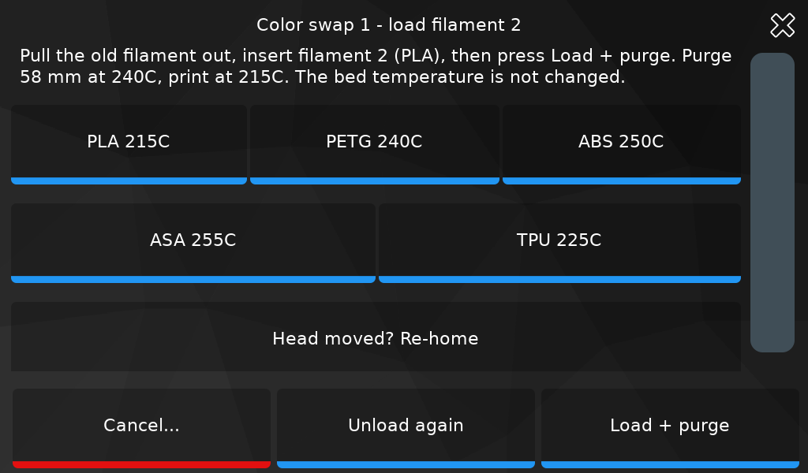
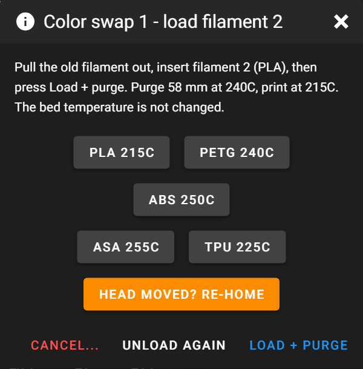
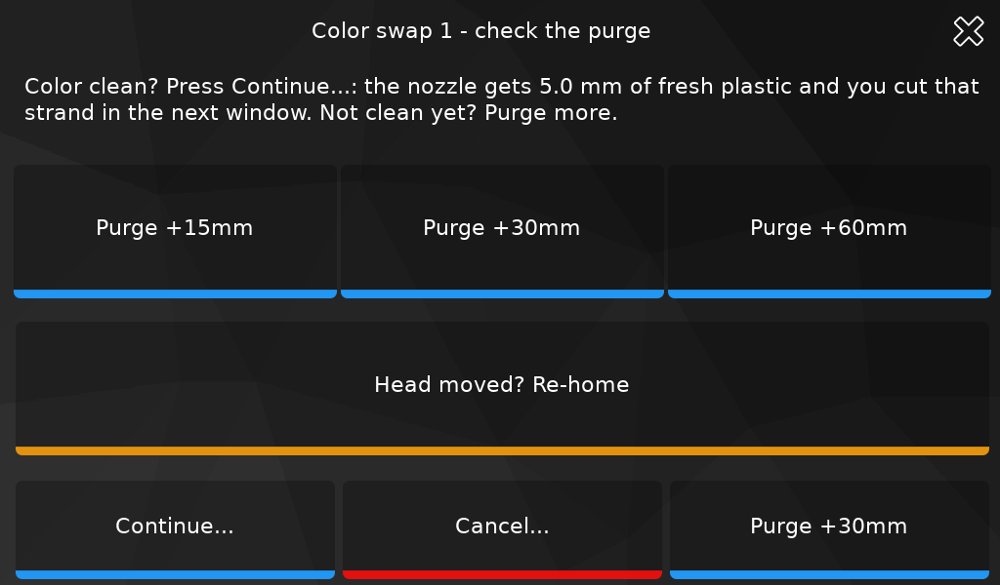
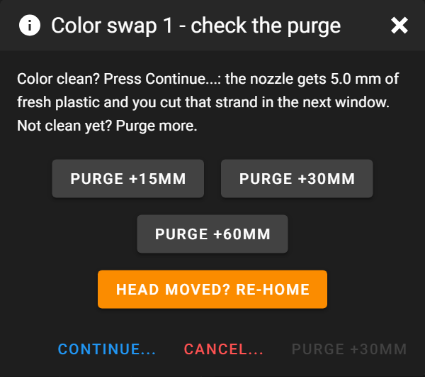
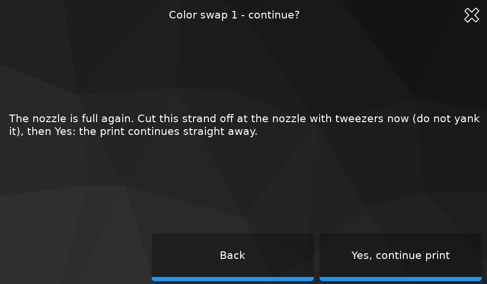
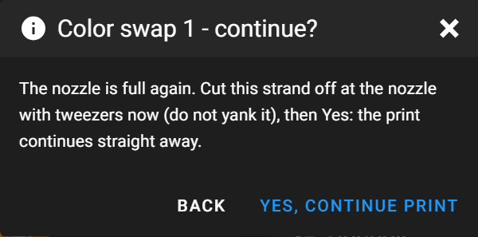

**English** | [العربية](%D8%A3%D8%AB%D9%86%D8%A7%D8%A1-%D8%A7%D9%84%D8%B7%D8%A8%D8%A7%D8%B9%D8%A9)

The printer lifts the head **up first**, then moves to the front edge and unloads the old filament while hot.

## Window 1: "Color swap - load filament 2"

<table><tr>
<td align="center"> KlipperScreen (HOME: the old filament is already out)</td>
<td align="center"> Mainsail — the same window</td>
</tr></table>

1. Pull out the old filament.
2. Insert the new filament.
3. Press **Load + purge**.

| Other button | When |
|---|---|
| **PLA 215C** / **PETG 240C** | The new filament is a different type from the one in the file |
| **Unload again** | The old filament did not come out |
| **Cancel...** | You want to cancel the print |

## Window 2: "Color swap - check the purge"

> While loading and purging, a window **with no buttons** appears ("please wait"). Wait until it closes.

<table><tr>
<td align="center"> KlipperScreen</td>
<td align="center"> Mainsail</td>
</tr></table>

4. Look at the filament coming out: is the color mixed? Press **Purge +15**, **+30** or **+60** (or the **Purge +30mm** button at the bottom right).
5. Press **Continue...** (bottom **left**). The nozzle gets **5 mm of fresh plastic** (6.6): it oozed while you looked at the color, and a half-empty nozzle draws a stretch of the layer with nothing coming out.
6. **Cut** that fresh strand at the nozzle with tweezers. Do not pull it hard (pulling empties the nozzle again).
7. Press **Yes, continue print**. What happens next:
   1. A tiny purge (1.5 mm) to fill the nozzle.
   2. **First layer only:** a short wipe line (a 10 cm arc) on the front-right edge of the bed, at 0.3 mm height.
      Each swap on the first layer draws its line 1.2 mm further in. It is skipped, with the reason shown, if the model is closer than 10 mm to the line.
   3. Return in one straight, fast move to the print position.

| Bottom buttons (version 5) | Left | Middle | Right |
|---|---|---|---|
| Window 1 | Cancel... | Unload again | **Load + purge** |
| Window 2 | **Continue...** (asks a second time) | Cancel... | Purge +30mm |
| The question | Back | — | **Yes, continue print** |

<table><tr>
<td align="center"> The question after Continue... (KlipperScreen)</td>
<td align="center"> Mainsail</td>
</tr></table>

Two taps in a row on the same spot never continue the print.

## I closed the window

- **KlipperScreen**: print screen → **Menu** → **Color swap**.
- **Mainsail**: the **COLOR_SWAP_PROMPT** macro button.

## The head moved while I was inserting the filament

1. Press **Head moved? Re-home** (it is in both windows).
2. The head goes all the way up, then comes down from the **center** to the purge height, then moves to the front edge.
3. Finish the swap as usual. **Continue print** returns to the correct point.

> Tip: hold the extruder body with your other hand while you push the filament.
