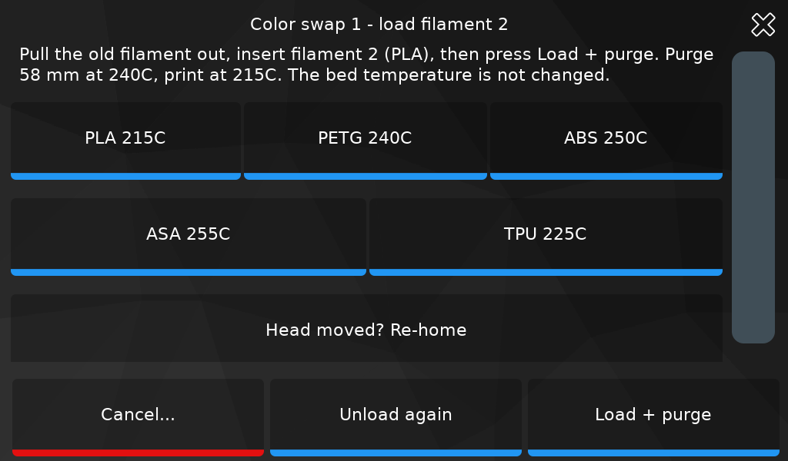
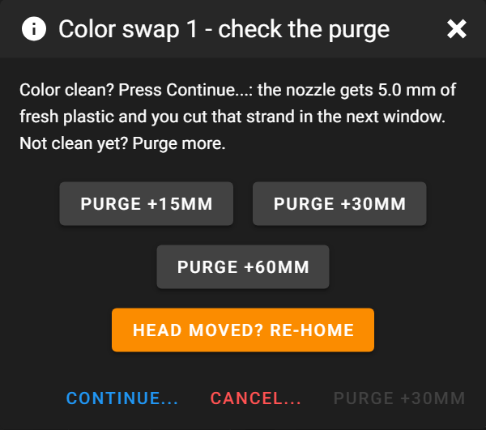
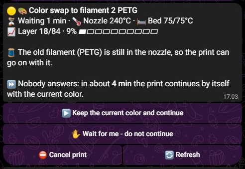

**English** | [العربية](%D8%A7%D9%84%D8%AF%D9%84%D9%8A%D9%84-%D8%A8%D8%A7%D9%84%D8%B9%D8%B1%D8%A8%D9%8A%D8%A9)

# COLOR_SWAP — multi-color printing on a single-extruder Klipper printer

**One** print file from OrcaSlicer. Whenever the print needs another color, the printer pauses by itself, parks the head above the model and opens a window on the printer screen (KlipperScreen) and in Mainsail. You swap the filament, press a button, and the print goes on exactly where it stopped.

Written and tested on a **FLSUN V400** (delta). Cartesian, CoreXY and bed-slinger printers use the same `color_swap.cfg`.

<table><tr>
<td align="center" valign="top"> KlipperScreen</td>
<td align="center" valign="top"> Mainsail</td>
<td align="center" valign="top"> Telegram</td>
</tr></table>

## What it does

| | |
|---|---|
| 🎨 **Guided swap** | Unload, load + purge, check the color, continue — one button per step, the same window on KlipperScreen and Mainsail |
| 🧪 **Right purge every time** | Takes Orca's flushing volume, adds extra for a material change and for going back to the main filament, purges in pulses |
| ✈️ **HOME / AWAY** | AWAY: nobody at the printer? After 5 min the print goes on with the color it has. A change of material always waits for a person |
| 📱 **Telegram control panel** | One pinned, self-updating panel, the swap card, a warning 10 min before each swap — buttons only |
| ⚡ **Power-cut resume** | Save points every layer; resume a stopped print from the screen |
| 🛡️ **Safe by design** | The nozzle never goes below the point where the slicer paused it |
| ⚙️ **Settings on the screen** | Every number has a button, an explanation and a factory value — no file editing |

## Start here

| Page | What is in it |
|---|---|
| [Installation](Installation) | FLSUN V400 in 10 minutes, any other Klipper printer in 15 |
| [OrcaSlicer setup](OrcaSlicer-Setup) | The two slicer lines and the purge amounts |
| [During the print](During-the-Print) | Every window of a color swap, step by step |
| [Resume a stopped print](Resume-a-Stopped-Print) | After a power cut or a cancel |
| [Alerts](Alerts) | Phone messages and the buzzer |
| [The settings window](Settings-Window) | Every setting, on the screen |
| [Away from the printer](Away-Mode) | HOME / AWAY, long waits, remote commands |
| [Telegram control panel](Telegram-Panel) | Control the printer from the chat |
| [Safety](Safety) | Why the head never hits the model |
| [Technical details](Technical-Details) | Files, filament accounting, all settings, what was verified |
| [Troubleshooting](Troubleshooting) | Gaps, purge amounts, hard unloading, frozen screen |

## Download

The latest package and what changed in each version: **[Releases](https://github.com/hushamQA/klipper-color-swap/releases)**.
Tutorial video (Arabic, version 2): [`video/`](https://github.com/hushamQA/klipper-color-swap/tree/main/video).

MIT license — use and change it freely, with credit.
