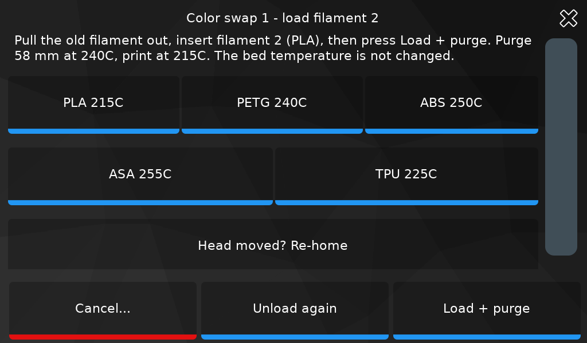
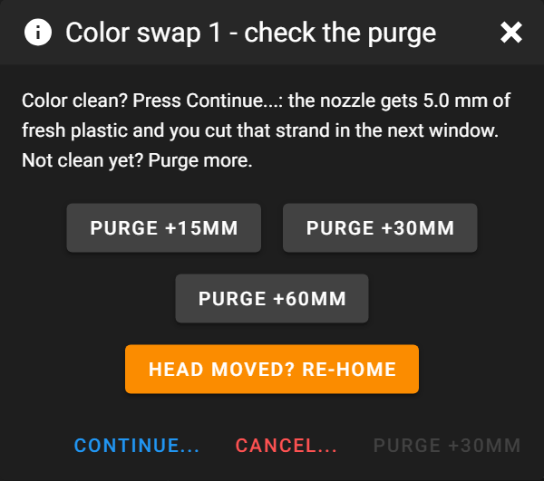
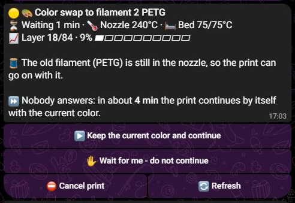

**العربية** | [English](Home)

# COLOR_SWAP — طباعة عدة ألوان بطابعة Klipper ذات رأس واحد

ملف طباعة **واحد** من OrcaSlicer. كلما احتاجت الطباعة لونًا آخر تتوقف الطابعة وحدها، وترفع الرأس فوق النموذج، وتفتح نافذة على شاشة الطابعة (KlipperScreen) وفي Mainsail. تبدّل الخيط، تضغط زرًا، وتكمل الطباعة من نفس المكان تمامًا.

كُتب وجُرّب على **FLSUN V400** (دلتا). الطابعات الكارتيزية و CoreXY وذات السرير المتحرك تستعمل نفس الملف `color_swap.cfg`.

<table><tr>
<td align="center" valign="top"> KlipperScreen</td>
<td align="center" valign="top"> Mainsail</td>
<td align="center" valign="top"> Telegram</td>
</tr></table>

## ماذا يفعل

| | |
|---|---|
| 🎨 **تبديل موجَّه** | سحب، تحميل + صخ، فحص اللون، متابعة — زر واحد لكل خطوة، ونفس النافذة على KlipperScreen و Mainsail |
| 🧪 **صخ مناسب كل مرة** | يأخذ كمية الصخ من Orca، ويضيف عند تغيّر الخامة وعند الرجوع للفيلمنت الأساسي، ويصخ على دفعات |
| ✈️ **HOME / AWAY** | AWAY: لا أحد عند الطابعة؟ بعد 5 دقائق تكمل الطباعة باللون الموجود. تغيير الخامة ينتظر شخصًا دائمًا |
| 📱 **لوحة تحكم Telegram** | لوحة واحدة مثبّتة تتحدّث وحدها، وبطاقة التبديل، وتنبيه قبل كل تبديل بـ 10 دقائق — أزرار فقط |
| ⚡ **الاستكمال بعد انقطاع الكهرباء** | نقطة حفظ كل طبقة؛ استكمال الطباعة المتوقفة من الشاشة |
| 🛡️ **آمن من الأساس** | الفوهة لا تنزل أبدًا تحت النقطة التي أوقف عندها السلايسر الطباعة |
| ⚙️ **الإعدادات على الشاشة** | لكل رقم زر وشرح وقيمة مصنع — بلا تعديل ملفات |

## ابدأ من هنا

| الصفحة | ما فيها |
|---|---|
| [التثبيت](%D8%A7%D9%84%D8%AA%D8%AB%D8%A8%D9%8A%D8%AA) | FLSUN V400 في 10 دقائق، وأي طابعة Klipper أخرى في 15 |
| [إعداد OrcaSlicer](%D8%A5%D8%B9%D8%AF%D8%A7%D8%AF-OrcaSlicer) | سطرا السلايسر وكميات الصخ |
| [أثناء الطباعة](%D8%A3%D8%AB%D9%86%D8%A7%D8%A1-%D8%A7%D9%84%D8%B7%D8%A8%D8%A7%D8%B9%D8%A9) | كل نوافذ تبديل اللون خطوة بخطوة |
| [استكمال طباعة متوقفة](%D8%A7%D8%B3%D8%AA%D9%83%D9%85%D8%A7%D9%84-%D8%B7%D8%A8%D8%A7%D8%B9%D8%A9-%D9%85%D8%AA%D9%88%D9%82%D9%81%D8%A9) | بعد انقطاع الكهرباء أو الإلغاء |
| [التنبيهات](%D8%A7%D9%84%D8%AA%D9%86%D8%A8%D9%8A%D9%87%D8%A7%D8%AA) | رسائل الهاتف والصفارة |
| [نافذة الإعدادات](%D9%86%D8%A7%D9%81%D8%B0%D8%A9-%D8%A7%D9%84%D8%A5%D8%B9%D8%AF%D8%A7%D8%AF%D8%A7%D8%AA) | كل إعداد، على الشاشة |
| [وأنت بعيد عن الطابعة](%D9%88%D8%B6%D8%B9-AWAY) | HOME / AWAY، الانتظار الطويل، الأوامر عن بعد |
| [لوحة تحكم Telegram](%D9%84%D9%88%D8%AD%D8%A9-Telegram) | تحكّم بالطابعة من المحادثة |
| [الأمان](%D8%A7%D9%84%D8%A3%D9%85%D8%A7%D9%86) | لماذا لا يصطدم الرأس بالنموذج |
| [تفاصيل تقنية](%D8%AA%D9%81%D8%A7%D8%B5%D9%8A%D9%84-%D8%AA%D9%82%D9%86%D9%8A%D8%A9) | الملفات، حساب الخيط، كل الإعدادات، ما تم التحقق منه |
| [حل المشاكل](%D8%AD%D9%84-%D8%A7%D9%84%D9%85%D8%B4%D8%A7%D9%83%D9%84) | الفراغات، كمية الصخ، صعوبة السحب، تجمّد الشاشة |

## التحميل

آخر حزمة وما تغيّر في كل إصدار: **[Releases](https://github.com/hushamQA/klipper-color-swap/releases)**.
فيديو الشرح (بالعربية، الإصدار 2): [`video/`](https://github.com/hushamQA/klipper-color-swap/tree/main/video).

رخصة MIT — استعمله وعدّله بحرية مع ذكر المصدر.

